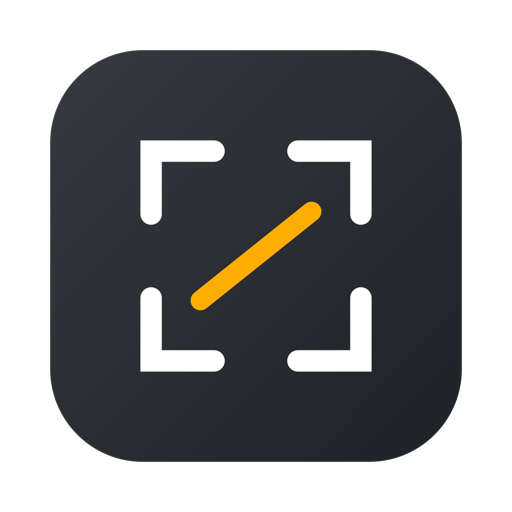

<p align="center">
  
</p>

<h1 align="center">anShot</h1>

<p align="center">
  <strong>专为 macOS 与 AI 工作流打造的原生截图、长截图、录屏、OCR 翻译与自动化工具</strong>
</p>

<p align="center">
  <strong>简体中文</strong> | <a href="README_EN.md">English</a>
</p>

<p align="center">
  
  
  
  
  <a href="LICENSE"></a>
</p>

<p align="center">
  <a href="#-为什么选择-anshot">亮点概览</a> ·
  <a href="#-核心功能">核心功能</a> ·
  <a href="#-ai-智能体协同mcp--cli--skill">MCP & CLI</a> ·
  <a href="#-下载与安装">下载安装</a> ·
  <a href="#-快捷键速查">快捷键</a> ·
  <a href="#-源码构建与架构">源码构建</a>
</p>

---

## 💡 为什么选择 anShot

**anShot** 是一款使用 **Swift 6** 与系统原生框架（AppKit、ScreenCaptureKit、Apple Vision、Apple Translation）深度构建的 macOS 菜单栏工具，无 Dock 图标、常驻轻盈、毫秒响应。

- **全能日常工具链**：区域与独立窗体截图、14 种可再编辑标注、双向与自动翻页长截图、双音轨 MP4/GIF 录屏、OCR 与划词/框选翻译、置顶贴图与历史归档，一站闭环。
- **为 AI Agent 原生设计**：内置官方规范的 **Model Context Protocol (MCP)** stdio 服务端、命令行工具与配套 Agent Skill。独创**跨进程授权复用**机制，终端和 Cursor / Claude Code / Windsurf 等 AI 宿主调用截图时自动复用 `anShot.app` 已有的屏幕录制权限，无需给宿主重复授权。
- **默认本地离线，隐私可控**：OCR、系统级翻译与长截图图像配准默认 **100% 本地离线执行**，像素与文本不出本机；同时支持按需接入 OpenAI 兼容、Claude、百度 PP-OCRv6 等云端引擎，外发时持续明示隐私边界。
- **工程化画质与体验**：全格式保留 Retina 原生 DPI 与独立窗体透明圆角，支持纯 Swift 无损 WebP 及 MIT 许可 `oxipng` 两阶段后台无损精压；支持浅色/深色/跟随系统三态外观与简体中文 / English 零重启热切换。

---

## ✨ 核心功能

### 📸 1. 精准捕获与独立窗体取景
- **零抖动静默冻结**：呼出即保持屏幕原亮度静默冻结，首帧显示放大镜与坐标取色 HUD（`C` 复制 HEX，`⇧C` 复制 RGB）。
- **两阶段异步智能吸附**：鼠标悬停实时高亮候选窗口与 UI 控件，支持最大化窗口防误吸，避免误选整屏。
- **所见即所得独立窗体捕获**：覆盖层内按 `Space`（或直接用 `⌃S`）切换独立窗体模式，支持 `Tab` / `⇧Tab` 穿透叠放窗口；默认合成原生柔和阴影（`⌥ + 单击` 临时切换无阴影），完整保留窗口透明圆角。
- **跨桌面与后台窗口**：可直接截取被完全遮挡或位于后台的窗口，亦可通过菜单栏「选择窗口…」精确取图，或通过「打开图片…」以只读方式载入磁盘图片继续标注。

### ✏️ 2. 「绘制优先 + 无缝直编」标注系统
- **14 种专业标注工具**：矩形、椭圆、直线、箭头、弯曲箭头（二次贝塞尔）、自由画笔、文字、框选/涂抹打码（像素马赛克 / 3-Pass 高斯模糊 / 纯色遮盖）、聚光灯（圆角压暗聚焦）、自增编号、正片叠底荧光笔、测量标尺、放大镜。
- **丝滑二次编辑**：画完自动选中控点，无需切回指针即可直接拖动刚画好或已有标注移动位置（已选中的空心框支持框内任意位置直接拖走；取消选中后空心框内部与未选中的高亮/聚光灯区域仍可自由叠加绘制，按 `⌘/⌃ + 拖拽` 可强制抓取底层标注）；绘图工具下亦可直接拉动选区边角微调范围、跨类型选中标注自动切换匹配属性面板，支持鼠标滚轮实时调节参数与方向键事务合并微调。
- **高度可定制**：支持常规矢量与手绘（Sketchy）双风格、自定义隐藏工具栏槽位（隐藏按钮仍保留快捷键）、带标注按 `Esc` 防误关二次确认、无限制撤销/重做（`⌘Z` / `⇧⌘Z`）。

### 📜 3. 自研滚动长截图
- **轻量高效配准内核**：采用自研「列权重 × 行运动 × 纹理」三重加权与竞争假设（Rival）分离度算法，支持**双向滚动**与连续流实时拼接。
- **自动翻页与智能净化**：内置可选**自动平滑翻页**（多档速度可调，人工滚动自动让权，触底自动收尾）；自动识别并净化吸顶/吸底导航栏与固定侧栏，并提供首帧兜底与**分段撤销（`⌘Z`）**。
- **防吞键控制体验**：会话期间采用 42pt 极简药丸控制栏 + 独立实时预览卡 + 瞬态热键防吞键；拼接完成打开独立结果窗，可继续复制、保存、钉图或无变形进入标注编辑器。

### 🎥 4. 屏幕录制与高清 GIF
- **灵活录制范围**：支持自定义区域、全屏以及**录制框实时跟随目标窗口移动**。
- **双独立音轨同步**：系统内录音频与麦克风声音各占独立音轨，结合静音对齐填充与单一时钟基准保证声画精准同步。
- **GIF 专项优化**：支持预设录制时长上限（15s / 30s / 60s）与分辨率缩放，实时显示倒计时与导出进度，转码失败自动保留临时原片防止素材丢失。

### 🔍 5. OCR、二维码扫描与多引擎翻译
- **全场景 OCR**：基于 Apple Vision 原生框架，完成冷启动优化与三级计算兜底，支持**超长图自动分块识别**、**二维码/条码扫描**、段内软换行智能合并，并支持从剪贴板或本地图片直接识别。
- **独立双态悬浮卡片**：OCR 与翻译结果以现代可缩放悬浮窗呈现，不锁死屏幕遮罩；支持**框选即译（`⌥S`）**、**全局划词翻译（`⌥D` 或可选划词悬浮按钮）**，以及将结果卡片一键钉在屏幕上。
- **本地默认 + 可选云端模型**：

| 能力 | 默认本机引擎（零外发） | 可选云端引擎（自配 API Key / Endpoint） |
|---|---|---|
| **文字识别 (OCR)** | Apple Vision（精确逐行坐标） | OpenAI 兼容多模态、Anthropic Claude、百度智能云 PP-OCRv6（带精确逐行坐标） |
| **文本翻译** | Apple 系统翻译（macOS 15.0+） | OpenAI 兼容、Anthropic Claude（低版本 macOS 同样可用） |

### 📌 6. 贴图置顶（Pin）与历史归档
- **多形态贴图**：截图、OCR 结果或剪贴板图像一键置顶悬浮，支持原地补画标注、滚轮缩放、透明度调节、鼠标穿透、边框开关与贴图上限管理。
- **统一历史记录**：截图、长截图、录屏自动入库；支持关键词搜索、按类型筛选、收藏、空格快览、再编辑、在访达中显示；复制或贴图生成的图像也会保留缓存，避免剪贴板被覆盖后丢失。

### 🎨 7. 画质导出、现代设置与可靠运维
- **多格式高保真导出**：支持 **PNG**、**JPEG**、**HEIC** 与 **纯 Swift 无损 WebP**（超出 WebP `16384px` 规格上限时自动安全降级 PNG），全格式携带 Retina 原生 DPI 元数据（2x 屏写入 144 DPI 防止预览发虚）。
- **MIT 无损 PNG 后台精压**：保存 PNG 时主路径零延迟写出，后台静默调用 MIT 许可 `oxipng` 执行安全精压并严格校验 `pHYs` 元数据后原子替换；未安装 `oxipng` 时静默保留原图，零风险零报错。
- **毛玻璃侧栏设置窗**：8 大分类（通用 / 截图与标注 / 快捷键 / 保存与导出 / 贴图 / 文字识别 / 翻译 / 关于），支持跨分类实时搜索、默认静默直存目录配置与剪贴板按需懒加载。
- **安全自动更新与崩溃诊断**：后台低打扰检查 GitHub Releases 更新，安装前依次校验 SHA256、`codesign`、Bundle ID 与版本号；内置崩溃日志查看器与长截图日志面板。

---

## 🤖 AI 智能体协同：MCP · CLI · Skill

anShot 让 AI 编程助手真正「看见」你的 macOS 界面，而不再盲猜布局。

### 🌟 独创「跨进程授权复用」
在 macOS 上，终端或 AI 宿主进程直接调取系统截屏 API 会被 TCC 拦截并要求反复授权。**anShot 默认通过自身已授权的 App 实例跨进程执行捕获与窗口枚举**，调用方（Terminal、Cursor、Claude Code、Windsurf、自动化脚本等）**无需单独申请屏幕录制权限**。

### 1. 命令行接口 (CLI)
将仓库中的 `tools/anshot` 软链到全局 `PATH` 即可使用（脚本会自动优先定位本地最新构建产物，其次使用 `/Applications/anShot.app`）：

```bash
mkdir -p ~/.local/bin
ln -sfn "<path-to-anShot>/tools/anshot" ~/.local/bin/anshot
```

常用命令（`stdout` 始终输出结构化 JSON，同名文件自动递增后缀绝不覆盖）：

```bash
# 查看显示器、桌面空间与窗口列表
anshot list-displays
anshot list-desktops
anshot list-windows

# 截取应用/窗口/区域/全屏（窗口被完全遮挡同样可截）
anshot capture --app "Safari" --out /tmp/safari.png
anshot capture --window 1234 --coordinate-grid --out /tmp/window.png
anshot capture --region 0,0,800,600 --format jpeg --quality 82 --out /tmp/region.jpg
anshot capture --max-size 0 --out /tmp/full-native.png

# 离线 OCR 文字识别（截屏或本地图片）
anshot ocr --app "Safari"
anshot ocr --image /tmp/screen.png --lang zh-Hans,en-US

# 探测目标窗口/应用内辅助功能 (AX) 控件树
anshot elements --app "Safari" --max-depth 4

# 有界时长录制（1...15 秒）输出 GIF 或 MP4
anshot record --app "Safari" --duration 4 --format gif --out /tmp/demo.gif
```

### 2. 接入 MCP（Cursor / Claude Desktop / Claude Code / Windsurf）

**正式安装版配置**（推荐）：

```json
{
  "mcpServers": {
    "anshot": {
      "command": "/Applications/anShot.app/Contents/MacOS/anShot",
      "args": ["--mcp"]
    }
  }
}
```

**源码开发调试配置**（使用包装脚本，注意参数为 `"mcp"` 而非 `"--mcp"`；或用 `tools/anshot path` 获取二进制路径）：

```json
{
  "mcpServers": {
    "anshot": {
      "command": "<path-to-anShot>/tools/anshot",
      "args": ["mcp"]
    }
  }
}
```

#### 内置 7 个标准 MCP 工具

| 工具名 | 能力说明 |
|---|---|
| `list_displays` | 获取所有显示器的 ID、逻辑尺寸、物理像素尺寸、缩放系数与全局位置 |
| `list_desktops` | 获取各显示器的桌面与全屏空间 ID、序号与当前活动状态 |
| `list_windows` | 按「在屏优先、面积降序」列出各桌面窗口的 ID、应用名、标题、矩形与所属空间 |
| `capture_screenshot` | 截取窗口/应用/区域/整屏；支持 `format`（`png`/`jpeg`）、`quality`、`coordinate_grid` 坐标标尺网格；默认 `max_size=1568`（`0` 为原图），未显式锁定 PNG 且超过 `3.5 MiB` 时自动降级高质量 JPEG 控制视觉 Token 体积 |
| `ocr_screenshot` | 离线识别屏幕/窗口/区域或本地图片文字，返回全文与逐行精确像素包围盒 |
| `inspect_window_elements` | 探测目标窗口或应用的 AX 控件树（角色、标题与逻辑点坐标框） |
| `record_screen` | 有界时长（`1...15` 秒）录制屏幕/区域/窗口为 GIF 或 MP4，用于验收动画与交互时序 |

### 3. 一键安装配套 Agent Skill
仓库内 `skills/anshot-screenshot/` 提供了面向 AI Agent 的完整截图操作规范，运行脚本即可全局安装到 `~/.agents/skills/`（并自动为已存在的 `~/.claude/skills`、`~/.codex/skills` 建立软链）：

```bash
./tools/install-skill.sh
```

---

## 🚀 下载与安装

### 预编译 DMG 安装
1. 前往 [GitHub Releases](https://github.com/zzhang-AL/anShot/releases) 下载最新版 `.dmg` 安装包（如 `anShot-1.1.0.dmg`）。
2. 双击打开 DMG，将 `anShot.app` 拖入 `Applications`（应用程序）目录。
3. 启动 anShot，在屏幕右上角菜单栏即可看到相机图标 📸。

> [!NOTE]
> **首次打开 Gatekeeper 放行说明**  
> 当前发行包采用自签名且未经过 Apple 公证。首次启动若提示「身份不明的开发者」或「已损坏，无法打开」，请任选其一放行：
> - 打开「**系统设置 → 隐私与安全性**」，在页面底部点击 **「仍要打开」**；
> - 或在终端执行：
>   ```bash
>   xattr -dr com.apple.quarantine /Applications/anShot.app
>   ```

### 系统权限说明

| 权限 | 级别 | 用途 |
|---|---|---|
| **屏幕录制** | 必需 | 截屏、独立窗体捕获、滚动长截图、屏幕录制与自动化截图 |
| **麦克风** | 可选 | 仅在屏幕录制需要录入旁白人声时使用 |
| **辅助功能** | 可选 | 控件级元素智能吸附、长截图自动翻页、全局划词翻译与 AX 控件树探测 |

---

## ⌨️ 快捷键速查

### 全局快捷键（默认）

| 快捷键 | 功能 | 说明 |
|---|---|---|
| `⌃ A` | **区域 / 窗口截图** | 呼出静默冻结覆盖层，拖拽选区或单击吸附目标 |
| `⌃ S` | **独立窗体截图** | 直接进入独立窗体取景模式（含透明圆角与柔和阴影） |
| `⌃ D` | **滚动长截图** | 框选滚动视口后手动滚动或启用自动翻页连续拼接 |
| `⌃ F` | **离线 OCR 识别** | 框选区域提取文字与二维码，在独立浮窗展示 |
| `⌃ R` | **屏幕录制** | 呼出录制面板，选择 MP4/GIF、帧率画质与双音轨 |
| `⌃ G` | **收起 / 展开贴图** | 一键隐藏或恢复屏幕上所有置顶贴图 |
| `⌥ S` | **框选翻译** | 框选区域执行 OCR 后自动弹出翻译结果 |
| `⌥ D` | **划词翻译** | 读取当前选中文本并弹出独立翻译悬浮卡片 |

> [!TIP]
> - 新安装默认采用防冲突方案（避开 macOS Mission Control `⌃1`–`⌃4` 冲突）；从旧版本升级的用户会自动无损保留原有 `⌃1`–`⌃5` 快捷键习惯。
> - 所有快捷键均可在「**设置 → 快捷键**」中自由录制、清空解绑或重置，且支持 **`F1`–`F20` 单键直接注册**。

### 覆盖层内高频快捷键

| 快捷键 | 动作 |
|---|---|
| `Space` | 在「区域框选」与「独立窗体捕获」之间切换（未框选态）；`Space + 拖拽` 平移选区 |
| `Tab` / `⇧ Tab` | 独立窗体模式下穿透光标下叠放窗口 |
| `⌥ + 单击` | 独立窗体捕获时临时切换「有/无柔和阴影」 |
| `C` / `⇧ C` | 复制放大镜十字准星处像素的 `HEX` / `RGB` 色值 |
| `Enter` / `⌘ C` | 复制结果并结束（双击选区空白亦可直接复制） |
| `⌘ S` / `⌘ P` | 保存到文件 / 钉在屏幕上（Pin） |
| `⌘ Z` / `⇧ ⌘ Z` / `⌘ D` | 撤销 / 重做 / 复刻当前选中标注 |
| `↑ ↓ ← →` / `⌥ + 方向键` | 1px 移动选区或选中标注（配 `⇧` 步长为 10px）；`⌥ + 方向键` 微调选区宽高（配 `⇧` 步长为 5px） |
| `Esc` | 退出当前会话（已绘制标注时默认触发防误关二次确认） |

---

## 🛠️ 源码构建与架构

本项目采用 **XcodeGen + 模块化本地 SPM** 架构，`project.yml` 为工程定义的唯一事实来源（严格解耦、无循环依赖）。

```text
anShot/
├── App/                          # 主应用入口、Info.plist、权限与图标资产
├── Packages/                     # 四大模块化本地 Swift Package
│   ├── AnShotCore/               # 纯核心层（无 AppKit/SwiftUI）：几何、标注渲染、长截图配准、历史与契约
│   ├── AnShotCapture/            # 采集与编码层：ScreenCaptureKit、Vision OCR、翻译、GIF/WebP/oxipng
│   ├── AnShotUI/                 # 交互界面层：覆盖层、标注栏、长截图/录屏控制、OCR/翻译卡片、设置窗
│   └── AnShotAutomation/         # 自动化接口层：MCP stdio 服务端、CLI 解析、跨进程授权复用与 AX 探测
├── skills/anshot-screenshot/     # 面向 AI Agent 的配套 Skill 文档
├── tools/                        # 构建、签名、发布打包、CLI 包装与 Skill 安装脚本
├── docs/                         # 各阶段设计方案、数据契约、任务清单与变更日志
└── project.yml                   # XcodeGen 工程配置（唯一事实来源）
```

### 1. 环境准备
- macOS 13.0 或更高版本
- Xcode 16.0 或更高版本（Swift 6.0 工具链）
- 安装 XcodeGen：
  ```bash
  brew install xcodegen
  ```
- 创建本地自签名证书 `"anShot Dev"`（固定签名身份，避免每次重编译导致 macOS 屏幕录制 TCC 授权失效）：
  ```bash
  ./tools/setup-dev-cert.sh
  ```
  *若仅验证编译、不需要保留本地权限，可在 `xcodebuild` 时传入 `CODE_SIGNING_ALLOWED=NO CODE_SIGNING_REQUIRED=NO CODE_SIGN_IDENTITY=""`。*

### 2. 生成工程并运行
```bash
git clone https://github.com/zzhang-AL/anShot.git
cd anShot
xcodegen generate
open anShot.xcodeproj
```

### 3. 运行全量单元测试
四个核心 SPM 包合计包含 **810+ 项自动化测试用例**：

```bash
for pkg in AnShotCore AnShotCapture AnShotAutomation; do
  swift test --package-path "Packages/${pkg}"
done
# AnShotUI 含 MainActor 定时抓帧用例，建议串行执行避免主线程调度竞争
swift test --package-path Packages/AnShotUI --no-parallel
```

### 4. 一键发布打包
执行自动化打包脚本（内置单元测试门禁、Universal 双架构编译、签名与版本号严格校验），在 `dist/` 生成 `anShot-<version>.dmg`、`anShot-<version>.zip` 与 `SHA256SUMS`：

```bash
./tools/make-release.sh
```

> 若需将 MIT 许可 `oxipng` 随包内嵌至 `Contents/Helpers/oxipng`，可将其放置于 `App/Helpers/oxipng` 或通过环境变量 `OXIPNG_BIN=/path/to/oxipng ./tools/make-release.sh` 指定。

### 📚 设计文档
完整架构设计、各阶段模型契约与实现记录请参阅 [docs/README.md](docs/README.md)。

---

## 🤝 参与贡献

欢迎通过 Issue 或 Pull Request 一起完善 anShot：

1. Fork 本仓库并创建功能分支：`git checkout -b feat/your-feature`
2. 完成开发并确保四个 SPM 包测试全部通过
3. 提交遵循约定式提交规范的 Commit：`git commit -m 'feat: add awesome feature'`
4. 推送分支并提交 Pull Request

---

## 📄 开源协议

本项目基于 **[MIT License](LICENSE)** 开源（全仓严格遵守 MIT 许可证兼容性，不引入 GPL 协议依赖）。你可以自由使用、修改与分发。
