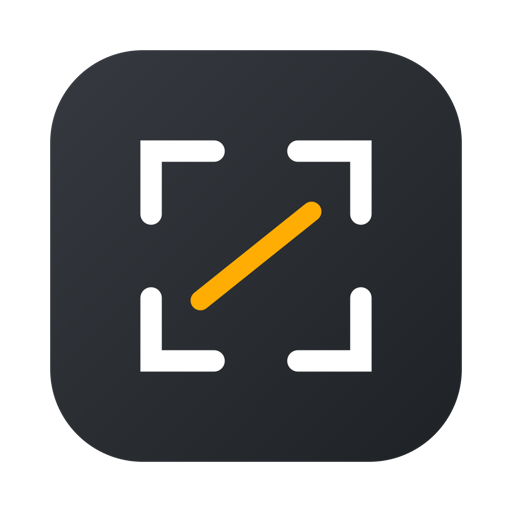

<p align="center">
  
</p>

<h1 align="center">anShot</h1>

<p align="center">
  <strong>专为 macOS 与 AI 时代打造的原生截图、长截图、屏幕录制与自动化工具。</strong>
</p>

<p align="center">
  
  
  
  
  <a href="LICENSE"></a>
</p>

---

## 💡 关于 anShot

**anShot** 是一款采用 Swift 6 原生开发、专为 macOS 深度定制的轻量级菜单栏截图与屏幕录制应用。

它不仅拥有极低的空闲资源占用（macOS 27 实测常驻约 23MB；OCR 预热已按 provider 门控）、毫秒级冷启动与无 Dock 图标的极简常驻形态，更在**工程深度**、**自研算法**以及**AI 智能体协同**上做了扎实的设计：

- **完备的日常工具链**：区域/窗口/全屏截图、两阶段智能元素吸附、全功能标注、双向滚动长截图、双音频轨 MP4/GIF 高清录制、离线 OCR 与原生翻译、贴图置顶（Pin）。
- **原生支持 AI Agent（MCP & CLI）**：内置官方规范的 **Model Context Protocol (MCP)** stdio 服务端与命令行工具。独创**授权复用机制**——终端和外部 AI 助手（Cursor、Windsurf、Claude Desktop 等）调用截图时直接复用 App 已有的屏幕录制权限，无需单独繁琐授权。
- **纯粹的隐私安全**：OCR、屏幕翻译与长截图图像配准默认**100% 本地离线处理**，像素与文本不出本机，杜绝云端泄露风险。

---

## ✨ 核心功能特性

### 📸 1. 精准捕获与智能识别
- **多维度捕获**：全屏、自定义区域、独立窗口、单应用全窗口捕获。
- **两阶段智能吸附**：鼠标悬停自动高亮候选区域，支持多层级视图与窗口边缘精确吸附。
- **跨桌面与遮挡捕获**：支持后台窗口以及被完全遮挡窗口的精准图像获取，不需要切换桌面或将应用置前。菜单栏「选择窗口…」可直接从窗口列表取图。
- **编辑已有图片**：菜单栏「打开图片…」把磁盘上的图片直接载入同一套标注编辑器，源文件只读、不会被改写。

### ✏️ 2. 流畅高效的标注系统
- **丰富工具库**：矩形、椭圆、直线、箭头、画笔、文本、马赛克/高斯模糊、高亮带。
- **智能计数序号**：点击即生成自增序号气泡，支持任意序号删除后自动重排。
- **尺寸测量标尺**：实时显示元素像素宽高与对齐参考。
- **标注可再编辑**：指针工具下点选已有标注即可拖动、删除、改颜色/线宽/字号；文字双击可重新编辑。
- **样式切换**：支持常规矢量与手绘（Sketchy）双重视觉风格，无损矢量缩放与无限制撤销/重做（`⌘Z` / `⇧⌘Z`）。

### 📜 3. 滚动长截图
- **纯自研加权配准内核**：采用「列权重 × 行运动 × 纹理」三重加权与竞争假设（Rival）分离度算法，轻量高效，彻底摆脱外部笨重依赖。
- **智能吸附过滤**：自适应识别并剔除视口吸顶导航栏（Sticky Header）与常驻底栏，避免正文拼接重叠重复。
- **双向滚动与实时预览**：支持正向滚动与向上回滚，悬浮窗提供整幅长图的等比缩略图与当前视口区间拖动指示。
- **结果窗口**：拼接完成后自动复制并打开结果窗口，可继续保存、再次复制、钉在屏幕上或进入编辑器继续标注；即使复制失败，结果也不会消失。

### 🎥 4. 屏幕录制与高质量 GIF
- **灵活区域选择**：支持选区、全屏，以及**录制框实时跟随目标窗口拖动**。
- **双声道独立录制**：系统内录音频与麦克风声音各占独立音轨，采用静音对齐填充与单一时钟基准，保证声画毫秒级同步。
- **GIF 专属优化**：录制前支持设置时长上限（15s/30s/60s）与分辨率缩放，录制中显示倒计时与进度百分比，具备转码失败保留临时原片的防丢失回退保护。

### 🔍 5. 本地 OCR 与系统级翻译
- **离线 OCR**：基于 Apple Vision 原生框架，毫秒级返回精确文本包围盒与文字流，完全离线运行。
- **系统翻译**：调用 macOS 原生系统级翻译框架，零外部网络请求，保障隐私安全。

### 📌 6. 贴图置顶（Pin）与历史记录
- **截图贴图**：一键将截图以独立置顶浮窗固定在屏幕最上层，支持滚轮缩放、透明度调节与鼠标穿透。
- **历史记录面板**：截图、长截图、录屏统一入账；支持搜索、按类型筛选、收藏、空格预览、复制、重新编辑、在访达中显示与删除。复制/钉住产生的图也会缓存一份，剪贴板被覆盖后仍可找回。

### 🔄 7. 自动更新与崩溃日志
- **自动更新**：启动后每天检查一次 GitHub Releases；发现新版本只发轻提示，不抢焦点。设置「关于」页可手动检查。
- **可校验的安装**：下载 zip 后依次校验 SHA256、解压、`codesign`、bundle id 与版本号；只允许在「应用程序」目录内自动替换，失败会给出原因并保留发布页入口。
- **崩溃日志**：菜单栏或设置「关于」页打开，列出 `DiagnosticReports` 中 anShot 的 `.ips/.crash` 报告，右侧查看只读原文；只读系统报告，不删除。

---

## 🤖 AI 智能体协同：内置 MCP 与 CLI

anShot 原生为现代开发者与 AI 编程设计，内置 MCP 服务端与 CLI 接口。

### 🌟 核心优势：独创「授权复用」
在 macOS 上，终端应用或 AI 宿主进程直接调用系统截图 API 通常会被系统 TCC 拦截并强制要求授权。
**anShot 默认通过应用自身的可执行文件跨进程协同截图**，调用方（无论是你的终端、Shell 脚本还是 Cursor/Claude）**完全不需要单独申请屏幕录制权限**！

### 1. 命令行接口 (CLI)
只需为仓库中的 `tools/anshot` 创建一个软链接即可在全局终端中使用：

```bash
mkdir -p ~/.local/bin
ln -sfn "<path-to-anShot>/tools/anshot" ~/.local/bin/anshot
```

常用命令：
```bash
# 获取当前显示器与窗口列表
anshot list-displays
anshot list-windows

# 截取整个主屏并保存
anshot capture --out /tmp/screen.png

# 截取指定应用窗口（即使被遮挡也无需切到前台）
anshot capture --app "Safari" --out /tmp/safari.png

# 截取特定窗口 ID 或指定逻辑点区域
anshot capture --window 1234 --out /tmp/window.png
anshot capture --region 0,0,800,600 --out /tmp/region.png
```

### 2. 在 AI 编辑器中接入 MCP (Cursor / Windsurf / Claude Desktop)

以 **Cursor / Claude Desktop** 为例，在你的 `mcp.json` 或 Claude Desktop 配置文件中添加：

```json
{
  "mcpServers": {
    "anshot": {
      "command": "/Applications/anShot.app/Contents/MacOS/anShot",
      "args": ["--mcp"]
    }
  }
}
```
*(如果你是源码调试阶段，也可以将 command 换为 `<仓库路径>/tools/anshot`)*

MCP 服务端提供以下三个标准工具：
- `capture_screenshot`: 截取屏幕、区域或指定后台窗口
- `list_windows`: 获取当前各桌面上的所有窗口 ID、所有者与标题
- `list_displays`: 获取系统所有显示器的 ID、名称与分辨率

---

## 🚀 下载与安装

### 预编译 DMG 安装
1. 前往 [Releases](https://github.com/zzhang-AL/anShot/releases) 页面下载最新版 `anShot-1.0.0.dmg`。
2. 打开 DMG，将 `anShot.app` 拖入 `/Applications`（应用程序目录）。
3. 启动 anShot。首次启动请在屏幕右上角菜单栏寻找相机图标 📸。

> **首次打开系统拦截说明（Gatekeeper）**：
> 如果您下载的安装包提示「身份不明的开发者」或「已损坏，无法打开」：
> - 可在「系统设置 → 隐私与安全性」页面底部点击**「仍要打开」**；
> - 或在终端执行放行命令：
>   ```bash
>   xattr -dr com.apple.quarantine /Applications/anShot.app
>   ```

### 必需权限授予
为了正常使用功能，请在首次使用相关功能时在「系统设置 → 隐私与安全性」中授权：
- **屏幕录制（必需）**：用于截屏与录屏。
- **麦克风（可选）**：仅在屏幕录制需要录入人声时申请。
- **辅助功能（可选）**：用于窗口快捷识别与增强定位。

---

## ⌨️ 常用快捷键（默认）

| 快捷键 | 动作 | 说明 |
|---|---|---|
| `⌃ 1` (`Control + 1`) | **区域 / 窗口截图** | 呼出全屏半透明遮罩，拖拽或单击窗口取景 |
| `⌃ 2` (`Control + 2`) | **屏幕录制** | 呼出录制准备面板，选择 MP4/GIF、画质与音频 |
| `⌃ 3` (`Control + 3`) | **滚动长截图** | 框选内容区域后滚动鼠标滚轮完成连续拼接 |
| `⌃ 4` (`Control + 4`) | **离线 OCR 文字识别** | 框选区域后立即提取图中文本并支持一键复制 |
| `⌃ 5` (`Control + 5`) | **收起 / 展开全部固定截图** | 隐藏或恢复屏幕上所有贴图 |

*截图、录制、长截图、OCR 与固定截图切换这五个快捷键，均可在菜单栏「设置 → 通用」中自由录制与修改。*

---

## 🛠️ 本地开发与源码构建

本项目采用 **XcodeGen + 模块化 SPM (Swift Package Manager)** 架构，工程结构完全代码化声明。

```
anShot/
├── App/                      # 主应用入口、Info.plist、资产与权限配置
├── Packages/                 # 核心模块（SPM 本地包，解耦无循环依赖）
│   ├── AnShotCore/           # 几何运算、长截图配准、标注渲染数据结构
│   ├── AnShotCapture/        # ScreenCaptureKit 录制流、Vision OCR、窗口拾取
│   ├── AnShotUI/             # 覆盖层、标注编辑面板、设置窗口、贴图浮窗
│   └── AnShotAutomation/     # MCP stdio 服务端协议实现与命令行解析
├── project.yml               # XcodeGen 工程配置文件（唯一事实来源）
├── tools/                    # 自动化脚本（打包 release、CLI 包装、图标生成）
```

### 1. 准备环境
- macOS 13.0 或更高版本
- Xcode 16.0 或更高版本（需 Swift 6.0 工具链）
- 安装 XcodeGen：
  ```bash
  brew install xcodegen
  ```

### 2. 生成工程与运行
```bash
# 1. 克隆仓库
git clone https://github.com/zzhang-AL/anShot.git
cd anShot

# 2. 根据 project.yml 生成 .xcodeproj
xcodegen generate

# 3. 使用 Xcode 打开或直接编译
open anShot.xcodeproj
```

### 3. 运行完整测试套件
项目各核心逻辑包具备高度覆盖的自动化测试（当前共 570+ 项测试用例）：
```bash
# 并行测试所有 SPM 核心包
for p in AnShotCore AnShotCapture AnShotAutomation AnShotUI; do
  (cd Packages/$p && swift test)
done
```

### 4. 发布打包
执行自动化打包脚本即可在 `dist/` 目录下一键生成 Universal 架构 DMG 与 ZIP 发布归档：
```bash
./tools/make-release.sh
```

---

## 🤝 参与贡献

非常欢迎通过 Issue 或 Pull Request 参与 anShot 的建设！

1. Fork 本仓库并新建分支：`git checkout -b feature/amazing-feature`
2. 提交您的修改：`git commit -m 'feat: add amazing feature'`
3. 确保本地单元测试全部通过：`swift test`
4. 推送分支并提交 Pull Request

---

## 📄 开源协议

本项目基于 **[MIT License](LICENSE)** 开源。你可以自由使用、修改和分发，商业与非商业皆可。
