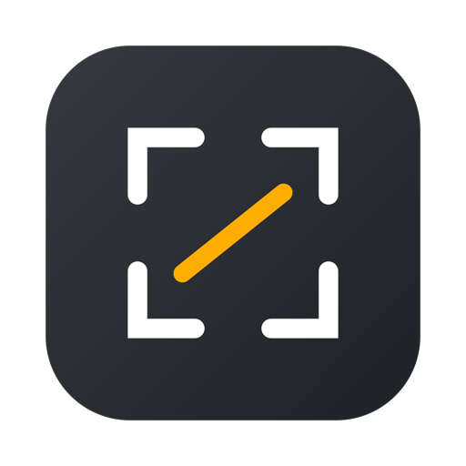

<p align="center">
  
</p>

<h1 align="center">anShot</h1>

<p align="center">
  <strong>Native macOS screenshot, scrolling capture, screen recording, OCR & translation, and AI automation tool</strong>
</p>

<p align="center">
  <a href="README.md">简体中文</a> | <strong>English</strong>
</p>

<p align="center">
  
  
  
  
  <a href="LICENSE"></a>
</p>

<p align="center">
  <a href="#-why-anshot">Overview</a> ·
  <a href="#-key-features">Features</a> ·
  <a href="#-ai-agent-integration-mcp--cli--skill">MCP & CLI</a> ·
  <a href="#-download--installation">Install</a> ·
  <a href="#-keyboard-shortcuts">Shortcuts</a> ·
  <a href="#-building-from-source--architecture">Build from Source</a>
</p>

---

## 💡 Why anShot

**anShot** is a lightweight macOS menu bar utility built natively with **Swift 6** and Apple's native frameworks (AppKit, ScreenCaptureKit, Apple Vision, and Apple Translation). It runs quietly without a Dock icon, uses minimal memory, and launches in milliseconds.

- **All-in-One Capture Workflow**: Area and standalone window capture, 14 re-editable annotation tools, bidirectional & auto-scrolling capture, dual-track MP4/GIF recording, OCR and text/selection translation, pinned screenshots, and unified history.
- **Built for AI Agents**: Ships with a spec-compliant **Model Context Protocol (MCP)** stdio server, a CLI wrapper, and a ready-to-use Agent Skill. Its **cross-process permission reuse** lets terminals and AI hosts (Cursor, Claude Code, Windsurf, Claude Desktop, etc.) reuse `anShot.app`'s existing Screen Recording permission without granting separate access to every host.
- **Offline & Private by Default**: OCR, system-level translation, and scrolling-capture image registration run **100% locally** by default so pixels and text never leave your Mac. Optional cloud providers (OpenAI-compatible, Claude, Baidu PP-OCRv6) are available on demand with clear privacy indicators.
- **Fidelity-First Engineering**: Preserves native Retina DPI and transparent rounded window corners across export formats, supports pure-Swift lossless WebP and MIT-licensed `oxipng` background PNG optimization, and offers Light/Dark/System themes plus instant hot-swapping between English and Simplified Chinese.

---

## ✨ Key Features

### 📸 1. Precision Capture & Standalone Window Mode
- **Zero-Jitter Silent Freeze**: Freezes the screen at native brightness on invocation with an immediate pixel loupe and color picker HUD (`C` to copy HEX, `⇧C` to copy RGB).
- **Two-Stage Async Smart Snapping**: Highlights windows and UI elements as you hover, with anti-false-snap protection against maximized windows.
- **WYSIWYG Standalone Window Capture**: Press `Space` inside the overlay (or use `⌃S`) to switch to standalone window mode. Cycle through overlapping windows beneath the cursor with `Tab` / `⇧Tab`, preserve native transparent rounded corners, and toggle soft drop shadows on the fly (`⌥ + Click`).
- **Background & Cross-Space Windows**: Capture occluded or background windows without bringing them to the front. Use **Choose Window…** from the menu bar to pick any window directly, or **Open Image…** to annotate existing image files read-only.

### ✏️ 2. "Draw-First, Edit-In-Place" Annotation System
- **14 Vector & Redaction Tools**: Rectangle, Ellipse, Line, Arrow, Curved Arrow (quadratic Bézier), Freehand Pen, Text, Area/Brush Redaction (Pixel Mosaic, 3-Pass Gaussian Blur, Solid Fill), Spotlight (rounded dimmed focus), Auto-Increment Numbering, Multiply Highlighter, Measurement Ruler, and Magnifier.
- **Seamless Re-Editing**: Newly drawn items auto-select with live handles—drag any just-drawn or existing annotation directly without switching back to the pointer tool (selected hollow rectangles/ellipses can be dragged from anywhere inside; once deselected, their interiors and unselected highlight/spotlight surfaces remain free for layered drawing, with `⌘/⌃ + Drag` to force-move underlying layers). You can also resize the capture selection handles from drawing tools, get auto-matched inspector panels when selecting a different annotation type, scroll the wheel to adjust parameters, and nudge cleanly with coalesced undo steps.
- **Customizable & Safe**: Toggle between clean vector and Sketchy hand-drawn styles, hide unused toolbar slots while keeping their shortcuts active, guard against accidental `Esc` dismissal when annotations exist, and enjoy unlimited Undo/Redo (`⌘Z` / `⇧⌘Z`).

### 📜 3. Custom Scrolling Capture Engine
- **In-House Registration Core**: Powered by a lightweight weighted registration algorithm (column weights × row motion × texture) with rival-hypothesis separation, supporting **bidirectional scrolling** and continuous stream stitching.
- **Auto-Scroll & Smart Cleanup**: Optional **smooth auto-scrolling** with configurable speeds (yields gracefully to manual wheel input and stops automatically at the bottom). Automatically filters sticky headers/footers and fixed sidebars, includes first-frame fallback, and supports **step-by-step Undo (`⌘Z`)**.
- **Uninterrupted Controls**: Features a compact 42pt pill control bar, a standalone live preview card, and session-scoped hotkeys so `Enter`/`Esc` are never swallowed by browsers or chat apps. Completed captures open in a dedicated result window to copy, save, pin, or annotate without aspect-ratio distortion.

### 🎥 4. Screen Recording & High-Quality GIF
- **Flexible Targets**: Record a custom region, full screen, or **dynamically track a moving target window**.
- **Synchronized Dual Audio Tracks**: Captures system audio and microphone input on separate tracks with silence padding and a single clock baseline for tight A/V sync.
- **GIF-Specific Safeguards**: Set duration limits (15s / 30s / 60s) and resolution scaling before recording, monitor live countdown and export progress, and retain temporary source footage automatically if transcoding fails.

### 🔍 5. OCR, QR/Barcode Scanning & Multi-Engine Translation
- **Versatile OCR**: Built on Apple Vision with cold-start optimization and three-tier compute fallback. Supports **chunked OCR for ultra-long images**, **QR & barcode detection**, optional soft line-break merging, and direct recognition from the clipboard or local image files.
- **Independent Floating Cards**: Modern resizable OCR and translation cards float freely outside the capture overlay. Supports **Capture & Translate (`⌥S`)**, **Selection Translate (`⌥D` or optional floating translate button)**, and one-click pinning of results.
- **Local by Default + Optional Cloud Providers**:

| Capability | Default On-Device Engine (Zero Data Sent) | Optional Cloud Engines (BYO API Key / Endpoint) |
|---|---|---|
| **OCR** | Apple Vision (precise line bounding boxes) | OpenAI-compatible Vision, Anthropic Claude, Baidu PP-OCRv6 (with precise line boxes) |
| **Translation** | Apple Translation (macOS 15.0+) | OpenAI-compatible, Anthropic Claude (works on macOS 13/14 too) |

### 📌 6. Pinned Screenshots (Pin) & Unified History
- **Floating Pins**: Pin screenshots, OCR outputs, or clipboard images above all windows. Supports in-place re-annotation, wheel zoom, opacity adjustment, click-through mode, optional borders, and configurable pin limits.
- **Unified History**: Automatically catalogs screenshots, scrolling captures, and recordings with search, type filtering, favorites, Quick Look (`Space`), re-editing, and Reveal in Finder. Copied and pinned images are cached so they remain recoverable even after the clipboard is overwritten.

### 🎨 7. High-Fidelity Export, Modern Settings & Diagnostics
- **Multi-Format Export**: Export as **PNG**, **JPEG**, **HEIC**, or **pure-Swift lossless WebP** (automatically falls back to PNG if dimensions exceed WebP's `16384px` spec limit), embedding native Retina DPI metadata (144 DPI on 2x displays) across formats.
- **MIT Lossless PNG Background Optimization**: Writes standard PNGs with zero latency on the main path, then asynchronously runs MIT-licensed `oxipng` in the background, verifies `pHYs` DPI preservation, and atomically replaces the file (silently skipped if `oxipng` is absent).
- **Frosted Sidebar Settings**: 8 organized sections (*General*, *Capture & Annotate*, *Shortcuts*, *Save & Export*, *Pinned*, *OCR*, *Translation*, *About*) with cross-section search, silent default save directory support, and lazy TIFF pasteboard encoding.
- **Verified Auto-Updates & Crash Logs**: Quietly checks GitHub Releases and verifies SHA256, `codesign`, Bundle ID, and version before replacing the app; includes built-in Crash Log and Scrolling Capture Log viewers.

---

## 🤖 AI Agent Integration: MCP · CLI · Skill

anShot lets AI coding assistants actually **see** your macOS UI instead of guessing layout details.

### 🌟 Cross-Process Permission Reuse
On macOS, terminals and AI hosts calling screen capture APIs directly are blocked by TCC unless each host is separately authorized. **anShot delegates capture and window enumeration to its own authorized app instance**, so callers (Terminal, Cursor, Claude Code, Windsurf, shell scripts) **never need Screen Recording permission of their own**.

### 1. Command-Line Interface (CLI)
Symlink `tools/anshot` into your `PATH` (it automatically prefers your local build output and falls back to `/Applications/anShot.app`):

```bash
mkdir -p ~/.local/bin
ln -sfn "<path-to-anShot>/tools/anshot" ~/.local/bin/anshot
```

Common commands (`stdout` always returns structured JSON; existing files are never overwritten):

```bash
# Inspect displays, desktop spaces, and windows
anshot list-displays
anshot list-desktops
anshot list-windows

# Capture an app, window, region, or full screen (works even on occluded windows)
anshot capture --app "Safari" --out /tmp/safari.png
anshot capture --window 1234 --coordinate-grid --out /tmp/window.png
anshot capture --region 0,0,800,600 --format jpeg --quality 82 --out /tmp/region.jpg
anshot capture --max-size 0 --out /tmp/full-native.png

# Offline OCR from screen or local image
anshot ocr --app "Safari"
anshot ocr --image /tmp/screen.png --lang zh-Hans,en-US

# Inspect the Accessibility (AX) UI hierarchy of an app or window
anshot elements --app "Safari" --max-depth 4

# Bounded screen recording (1...15 seconds) to GIF or MP4
anshot record --app "Safari" --duration 4 --format gif --out /tmp/demo.gif
```

### 2. MCP Server Setup (Cursor / Claude Desktop / Claude Code / Windsurf)

**Installed App (Recommended)**:

```json
{
  "mcpServers": {
    "anshot": {
      "command": "/Applications/anShot.app/Contents/MacOS/anShot",
      "args": ["--mcp"]
    }
  }
}
```

**Local Source Build** (uses the wrapper script—note `"mcp"` without dashes—or run `tools/anshot path` to get the binary path):

```json
{
  "mcpServers": {
    "anshot": {
      "command": "<path-to-anShot>/tools/anshot",
      "args": ["mcp"]
    }
  }
}
```

#### 7 Built-in MCP Tools

| Tool | Description |
|---|---|
| `list_displays` | Lists all displays with ID, logical size, physical pixel size, scale factor, and global origin |
| `list_desktops` | Lists macOS Spaces / full-screen desktops per display (`id`, `displayID`, `isCurrent`) |
| `list_windows` | Lists windows across spaces sorted by on-screen priority and area (`id`, `appName`, `title`, `frame`, `spaceIDs`) |
| `capture_screenshot` | Captures a window, app, region, or display. Supports `format` (`png`/`jpeg`), `quality`, and `coordinate_grid` rulers. Defaults to `max_size=1568` (`0` for native resolution) and auto-falls back to JPEG (`quality=82`) when an unconstrained PNG exceeds `3.5 MiB` to save vision tokens |
| `ocr_screenshot` | Runs offline OCR on a screen target or local image file, returning full text and line-level pixel bounding boxes |
| `inspect_window_elements` | Traverses the Accessibility (AX) element tree of a target window or app (role, title, logical frame) |
| `record_screen` | Records a bounded clip (`1...15` seconds) of a screen/region/window to GIF or MP4 for verifying animations and UI transitions |

### 3. Install the Companion Agent Skill
The repository includes a ready-to-use Agent Skill in `skills/anshot-screenshot/`. Install it globally to `~/.agents/skills/` (and auto-link into existing `~/.claude/skills` and `~/.codex/skills` directories):

```bash
./tools/install-skill.sh
```

---

## 🚀 Download & Installation

### Prebuilt DMG
1. Download the latest `.dmg` release (e.g. `anShot-1.1.0.dmg`) from [GitHub Releases](https://github.com/zzhang-AL/anShot/releases).
2. Open the DMG and drag `anShot.app` into `Applications`.
3. Launch anShot and look for the camera icon 📸 in the top-right menu bar.

> [!NOTE]
> **First-Launch Gatekeeper Notice**  
> Release builds are currently self-signed and not Apple-notarized. If macOS reports an unidentified developer or damaged app on first launch:
> - Open **System Settings → Privacy & Security** and click **Open Anyway** near the bottom; or
> - Run in Terminal:
>   ```bash
>   xattr -dr com.apple.quarantine /Applications/anShot.app
>   ```

### Permissions

| Permission | Requirement | Purpose |
|---|---|---|
| **Screen Recording** | Required | Screenshots, standalone window capture, scrolling capture, screen recording, and automation |
| **Microphone** | Optional | Voiceover recording during screen capture |
| **Accessibility** | Optional | UI element snapping, scrolling auto-scroll, selection translation, and AX tree inspection |

---

## ⌨️ Keyboard Shortcuts

### Global Shortcuts (Default)

| Shortcut | Action | Description |
|---|---|---|
| `⌃ A` | **Capture Area / Window** | Opens the silent-freeze overlay to drag a region or snap to an element |
| `⌃ S` | **Capture Standalone Window** | Enters standalone window mode with transparent rounded corners and shadow |
| `⌃ D` | **Scrolling Capture** | Select a scrollable viewport and stitch manually or via auto-scroll |
| `⌃ F` | **Offline OCR** | Select a region to extract text and QR/barcodes into a floating card |
| `⌃ R` | **Record Screen** | Opens the recording panel for MP4/GIF, quality, and dual audio tracks |
| `⌃ G` | **Toggle Pinned Screenshots** | Hides or restores all pinned floating screenshots |
| `⌥ S` | **Capture & Translate** | Runs OCR on a selected area and translates immediately |
| `⌥ D` | **Translate Selection** | Reads currently selected text and opens the floating translation card |

> [!TIP]
> - Fresh installs use conflict-free defaults (avoiding macOS Mission Control `⌃1`–`⌃4`). Users upgrading from earlier versions automatically keep their existing `⌃1`–`⌃5` bindings.
> - Every shortcut can be customized, cleared/unbound, or reset in **Settings → Shortcuts**, including single-key **`F1`–`F20`** bindings.

### Overlay Shortcuts

| Shortcut | Action |
|---|---|
| `Space` | Toggle between Area and Standalone Window mode (before selecting); `Space + Drag` pans the selection |
| `Tab` / `⇧ Tab` | Cycle through stacked windows beneath the cursor in window mode |
| `⌥ + Click` | Temporarily invert window drop-shadow setting during standalone window capture |
| `C` / `⇧ C` | Copy `HEX` / `RGB` color under the loupe crosshair |
| `Enter` / `⌘ C` | Copy to clipboard and finish (double-clicking empty space inside selection also copies) |
| `⌘ S` / `⌘ P` | Save to file / Pin to screen |
| `⌘ Z` / `⇧ ⌘ Z` / `⌘ D` | Undo / Redo / Duplicate selected annotation |
| `Arrow Keys` / `⌥ + Arrows` | Nudge selection or annotation by 1px (`⇧` = 10px); `⌥ + Arrows` resizes selection by 1px (`⇧` = 5px) |
| `Esc` | Cancel session (prompts for confirmation when annotations are present) |

---

## 🛠️ Building from Source & Architecture

anShot uses **XcodeGen + modular local Swift Packages**, with `project.yml` as the single source of truth and strict acyclic module boundaries.

```text
anShot/
├── App/                          # App entry point, Info.plist, entitlements & icons
├── Packages/                     # Modular local Swift Packages
│   ├── AnShotCore/               # Pure core (no AppKit/SwiftUI): geometry, renderer, stitcher, history, contracts
│   ├── AnShotCapture/            # Capture & encoding: ScreenCaptureKit, Vision OCR, translation, GIF/WebP/oxipng
│   ├── AnShotUI/                 # UI layer: overlay, annotation bar, scrollshot/recording UI, OCR/translation cards, settings
│   └── AnShotAutomation/         # Automation layer: MCP stdio server, CLI parser, permission-reusing IPC & AX inspector
├── skills/anshot-screenshot/     # Companion Agent Skill definition
├── tools/                        # Dev signing, release packaging, CLI wrapper & skill installer scripts
├── docs/                         # Architecture plans, data contracts, task trackers & changelogs
└── project.yml                   # XcodeGen project specification (single source of truth)
```

### 1. Prerequisites
- macOS 13.0 or later
- Xcode 16.0 or later (Swift 6.0 toolchain)
- Install XcodeGen:
  ```bash
  brew install xcodegen
  ```
- Create the local self-signed development certificate `"anShot Dev"` (keeps your macOS Screen Recording TCC permission intact across rebuilds):
  ```bash
  ./tools/setup-dev-cert.sh
  ```
  *To test compilation without signing, pass `CODE_SIGNING_ALLOWED=NO CODE_SIGNING_REQUIRED=NO CODE_SIGN_IDENTITY=""` to `xcodebuild`.*

### 2. Generate & Build
```bash
git clone https://github.com/zzhang-AL/anShot.git
cd anShot
xcodegen generate
open anShot.xcodeproj
```

### 3. Run the Test Suite
All four local Swift packages include **810+ automated unit tests**:

```bash
for pkg in AnShotCore AnShotCapture AnShotAutomation; do
  swift test --package-path "Packages/${pkg}"
done
# Run AnShotUI serially to avoid MainActor timer contention
swift test --package-path Packages/AnShotUI --no-parallel
```

### 4. Release Packaging
Run the release script (includes the unit-test gate, Universal `arm64 + x86_64` Release build, code signature & version verification) to generate `anShot-<version>.dmg`, `anShot-<version>.zip`, and `SHA256SUMS` under `dist/`:

```bash
./tools/make-release.sh
```

> To bundle MIT-licensed `oxipng` inside `Contents/Helpers/oxipng`, place the binary at `App/Helpers/oxipng` or run `OXIPNG_BIN=/path/to/oxipng ./tools/make-release.sh`.

### 📚 Design Docs
For detailed module contracts, algorithms, and milestone logs, see [docs/README.md](docs/README.md).

---

## 🤝 Contributing

Issues and Pull Requests are welcome!

1. Fork the repository and create a branch: `git checkout -b feat/your-feature`
2. Implement your changes and ensure all four Swift package test suites pass
3. Commit using Conventional Commits: `git commit -m 'feat: add awesome feature'`
4. Push your branch and open a Pull Request

---

## 📄 License

Released under the **[MIT License](LICENSE)** (strictly MIT-compatible dependencies throughout—no GPL dependencies). Free for both personal and commercial use.
